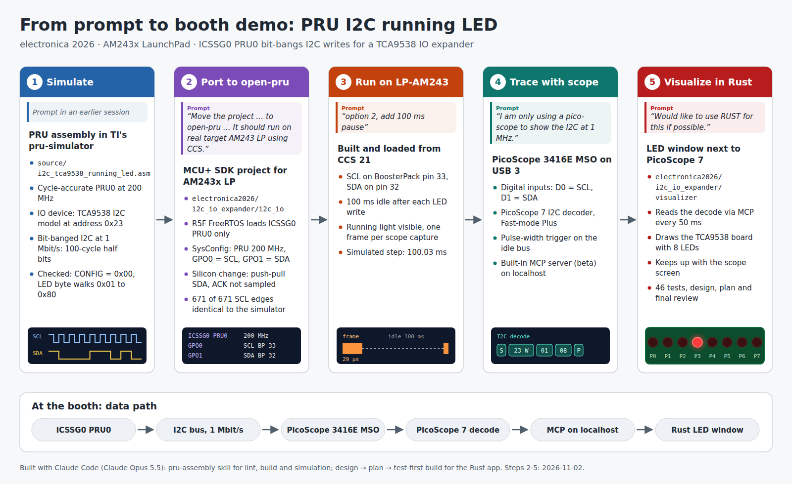

# I2C IO Expander (electronica 2026)

## Introduction

ICSSG0 PRU0 bit-bangs a 1 Mbit/s I2C master on two direct GPO pins and drives
a running LED on a TCA9538 8-bit IO expander. The firmware was developed and
verified in TI's pru-simulator (`source/i2c_tca9538_running_led.asm`) and then
ported to the AM243x LaunchPad. The R5F (MCU+ SDK, FreeRTOS) configures pin
mux and the PRU clock, and then loads and starts PRU0 only.

The porting effort, including what changed between the simulator and silicon,
is documented in [docs/porting_report.md](docs/porting_report.md).

For the booth demo, [../visualizer](../visualizer/readme.md) shows the 8 LEDs
on the PC, driven by PicoScope 7's I2C decode of this bus.

## Supported Combinations

| Processor | Board            | PRU core   | Host            |
| --------- | ---------------- | ---------- | --------------- |
| AM243x    | AM243x LaunchPad | ICSSG0 PRU0 | r5fss0-0 FreeRTOS |

Refer to open-pru/examples/readme.md > Supported processors per-project for
porting information.

## Validated HW & SW

| Processor | Hardware                           | Software                                  |
| --------- | ---------------------------------- | ----------------------------------------- |
| AM243x    | LP-AM243, revision REV A           | MCU+ SDK 12.01.00.33, CCS 21.0.1, ti-cgt-pru 2.3.3, SysConfig 1.28.1. Bus checked with a PicoScope 3416E MSO, including the 100 ms pause build: decode walks 0x01 ... 0x80, one step per 100 ms |

The project builds with MCU+ SDK 12.01.00.33. The open-pru release notes list
MCU+ SDK 11.1 - 12.0 as validated for AM243x.

## Overview

### What the firmware does

1. Drive the idle bus (SCL = 1, SDA = 1).
2. Write TCA9538 Configuration register 0x03 = 0x00 (all 8 ports outputs).
3. Forever: write Output Port register 0x01 with a single set bit that walks
   0x01 -> 0x02 -> ... -> 0x80 -> 0x01. One write takes 5843 PRU cycles
   (29.2 us at 200 MHz) at 1 Mbit/s, followed by a 100 ms pause with the bus
   idle (`PAUSE_COUNT` in `firmware/main.asm`). The LED steps about every
   100 ms, so the running light is visible by eye, and a scope can trigger on
   every frame.

### PRU resources

| Resource         | Setting                                              |
| ---------------- | ---------------------------------------------------- |
| Core             | ICSSG0 PRU0 only (PRU1, RTU_PRU and TX_PRU not loaded) |
| Core clock       | 200 MHz (`example.syscfg`, `coreClk`)                |
| GPO mode         | Direct GPIO, GPCFG0 GP_MUX_SEL = 0 (set by R5F)       |
| SCL              | R30 bit 0 = PRG0_PRU0_GPO0                           |
| SDA              | R30 bit 1 = PRG0_PRU0_GPO1                           |
| DRAM0 0x0FFE     | Soft NACK error flag (inactive on silicon, see below) |

### I2C timing

| Phase               | PRU cycles | Time    |
| ------------------- | ---------- | ------- |
| Data bit, SCL low   | 100 - 101  | 500 ns  |
| Data bit, SCL high  | 101        | 505 ns  |
| ACK bit, SCL low    | 99         | 495 ns  |
| ACK bit, SCL high   | 99         | 495 ns  |

Measured edge to edge in pru-simulator at 200 MHz.

### Limitations on silicon

- **Push-pull SDA, no ACK check.** On AM243x a PRU pad is muxed either as GPO
  or as GPI, and GPO drives push-pull. The firmware therefore drives SDA low
  during the ACK clock instead of releasing it, and does not sample ACK. A
  missing or wrongly addressed TCA9538 is not detected.
- **1 Mbit/s exceeds the TCA9538 rating.** The TCA9538 datasheet specifies
  400 kHz maximum (tLOW >= 1.3 us, tHIGH >= 0.6 us). To run inside the
  specification, set `DELAY_COUNT` in `firmware/main.asm` to 130 or higher.
  TCA9534 supports the 1 Mbit/s data rate but has only 4 outputs. 

## Steps to Run the Example

### Hardware setup

Connect a TCA9538 board to the LaunchPad BoosterPack header:

| Signal | PRU signal      | LP BoosterPack pin | TCA9538 pin |
| ------ | --------------- | ------------------ | ----------- |
| SCL    | PRG0_PRU0_GPO0  | BP.33 (J4)         | SCL         |
| SDA    | PRG0_PRU0_GPO1  | BP.32 (J4)         | SDA         |
| 3V3    | -               | BP.1 (J1)          | VCC         |
| GND    | -               | BP.20 (J2)         | GND         |

- Tie TCA9538 A1 and A0 high (address 0x23) and RESET high.
- Power the TCA9538 from 3.3 V. The PRU pins are 3.3 V push-pull outputs.
- Pull-up resistors on SCL and SDA are not required, because the PRU drives
  both lines push-pull. Pull-ups on the expander board do no harm.
- Connect LEDs with series resistors to P0 - P7.

The LaunchPad headers are labelled with BoosterPack pin numbers. The pin
numbers for PRU0 GPO0 and GPO1 come from the LP pin mapping in
`examples/LCD_interface/documents/PRU IO - LCD Interface.pptx` (slide 6).

### Build and run

1. Build the PRU project `i2c_io_am243x-lp_icss_g0_pru0_fw_ti-pru-cgt` first.
   It generates `firmware/am243x-lp/pru0_load_bin.h`.
2. Build the R5F project `i2c_io_am243x-lp_r5fss0-0_freertos_ti-arm-clang`.
3. Load and run the R5F project. Only PRU0 of ICSSG0 is loaded and started.
   The UART console prints `I2C IO expander: ICSSG0 PRU0 running`.

### Validate

- On a logic analyzer: SCL period about 1 us, START, address byte 0x46,
  register 0x01, data byte, STOP, repeating every 100 ms. The data byte walks
  0x01 -> 0x80. Trigger on the falling edge of SDA while SCL is high (START).
- During the 9th clock of every byte, SDA is low (driven by the PRU, and also
  by the TCA9538 when it acknowledges).
- With LEDs on P0 - P7, a single LED runs from P0 to P7 in 0.8 s.
