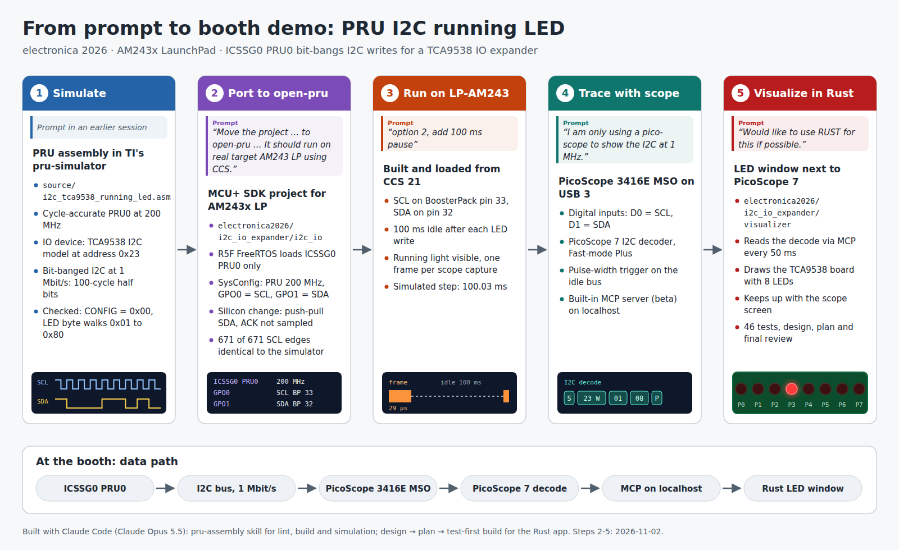

# I2C IO expander demo (electronica 2026)

ICSSG0 PRU0 on an AM243x LaunchPad bit-bangs a 1 Mbit/s I2C master and writes
a running-LED pattern for a TCA9538 8-bit IO expander. The demo runs the same
firmware idea through four stages: TI's pru-simulator, the LP-AM243 target,
a PicoScope capture of the real bus, and a Rust window that lights the 8 LEDs
from PicoScope's I2C decode.



| Folder | Content |
| ------ | ------- |
| [i2c_io](i2c_io/readme.md) | PRU firmware and MCU+ SDK (R5F FreeRTOS) project for the LP-AM243 |
| [visualizer](visualizer/readme.md) | Rust LED window, reads PicoScope 7's I2C decode |
| [docs](docs) | Development flow image (`development_flow.svg`/`.png`, generated by `development_flow.py`) |

How the firmware was ported from the simulator to the target, with the
prompts, decisions and measurements, is in
[i2c_io/docs/porting_report.md](i2c_io/docs/porting_report.md).

## Running the demo

### 1. Simulate (optional, no hardware)

In [TI pru-simulator](https://github.com/TexasInstruments/pru-simulator)
(`pip install -r requirements.txt`, then `python ui/server.py`, then open
`http://localhost:8080`):

1. Open `source/i2c_tca9538_running_led.asm` and click **Load & Assemble**.
2. In the IO panel, click **Attach TCA9538 @ 0x23 (SCL=bit0, SDA=bit1)**.
3. Set the step interval to `0.01` s and click **Run**.

The **I2C · TCA9538** section shows `CONFIG=0x00`, then one LED walking from
P0 to P7. Details: pru-simulator `getting_started.md`, Example 10.

The simulator runs the original source. The target firmware in `i2c_io`
differs in three places, all described in the porting report:

- **SDA:** the target drives SDA push-pull, where the simulator source uses
  open-drain.
- **ACK:** the target does not sample the ACK bit.
- **Pause:** the target pauses 100 ms after each LED write.

### 2. Build and run on the LP-AM243

Follow [i2c_io/readme.md › Steps to Run the Example](i2c_io/readme.md#steps-to-run-the-example):

1. Connect the wiring: SCL on BoosterPack pin 33, SDA on pin 32.
2. In CCS, build the PRU project and then the R5F project, then load and run
   the R5F project.
3. The UART console prints `I2C IO expander: ICSSG0 PRU0 running`.

CCS copies the source files when it imports a project. After changing
`i2c_io/firmware/main.asm` in this repository, copy it into the CCS
workspace project or import the project again.

### 3. Trace with the PicoScope

Follow [visualizer/readme.md › PicoScope 7 setup](visualizer/readme.md#picoscope-7-setup):

1. Connect the PicoScope MSO digital inputs: D0 = SCL, D1 = SDA.
2. Set a pulse-width trigger (positive pulse > 1 µs, Repeat).
3. Enable PicoScope 7's MCP server (beta), port 18123.

PicoScope 7 then decodes one frame per capture, about every 100 ms:
`23 W 01 xx`, with xx walking 01 → 80.

### 4. Show the LEDs

```
cd visualizer
source ~/.cargo/env    # only if cargo is not on PATH
cargo run --release
```

Place the window next to PicoScope 7. The lit LED follows the decoded data
byte, in step with the scope screen. See
[visualizer/readme.md](visualizer/readme.md) for options and status
messages.
