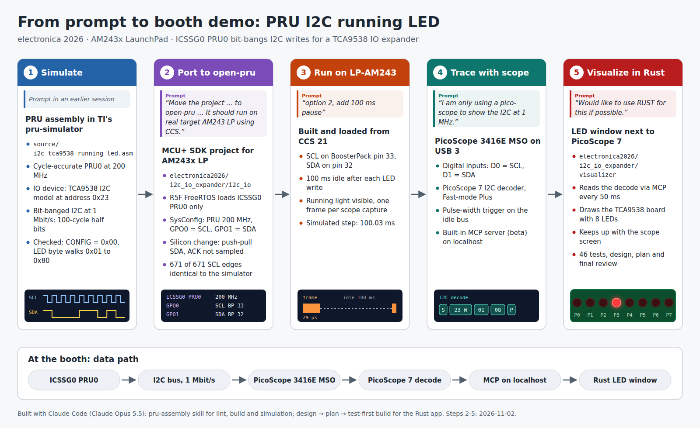

# I2C LED visualizer (electronica 2026)

## Introduction

A Rust desktop app that runs next to PicoScope 7 at the electronica 2026
booth. The LP-AM243 runs the [i2c_io](../i2c_io/readme.md) example: ICSSG0
PRU0 bit-bangs 1 Mbit/s I2C and writes a running-LED pattern to a TCA9538.
PicoScope 7 captures and decodes the bus. This app reads PicoScope 7's I2C
decode through PicoScope 7's built-in MCP server and draws the TCA9538 board
with its 8 LEDs, lit as the last decoded data byte says.

PicoScope 7 keeps ownership of the scope. The app never uses the Pico SDK or
USB. The design is in [docs/design.md](docs/design.md), the implementation
plan in [docs/plan.md](docs/plan.md).



## Requirements

- Linux desktop (tested on Ubuntu, GNOME, Wayland).
- PicoScope 7 7.2.30 or later, with a PicoScope MSO (tested: PicoScope 3416E
  MSO).
- The i2c_io example running on the LP-AM243 (firmware with the 100 ms pause
  per LED step).
- Rust stable, installed with [rustup](https://rustup.rs):
  `curl --proto '=https' --tlsv1.2 -sSf https://sh.rustup.rs | sh`.
  rustup installs `cargo` into `~/.cargo/bin`. If `cargo` is not found in a
  new terminal, run `source ~/.cargo/env` first.

## PicoScope 7 setup

1. Enable the MCP server feature. In PicoScope 7.2.30 it is hidden behind a
   feature flag in a root-owned file. Keep a backup, then switch it on:

   ```
   sudo cp /opt/picoscope/lib/PicoScope.GTK.dll.config /opt/picoscope/lib/PicoScope.GTK.dll.config.orig
   sudo sed -i '/PicoMCPEnabled/s/false/true/' /opt/picoscope/lib/PicoScope.GTK.dll.config
   grep PicoMCPEnabled /opt/picoscope/lib/PicoScope.GTK.dll.config
   ```

   The last line must show `value="true"`. A PicoScope package update
   resets the file. The MCP server is a beta feature.
2. Restart PicoScope 7. In Preferences → MCP server (beta), set the mode to
   **On for current session** and the port to **manual, 18123**.
3. Connect the digital inputs: **D0 = SCL**, **D1 = SDA**.
4. Trigger: **PulseWidth** on the digital line, positive pulse longer than
   1 µs, mode **Repeat**. It fires on the idle-high stretch before each
   START, so every capture holds one frame.

The app looks for an enabled I2C decoder with Data = D1 and Clock = D0. If
there is only a disabled one, it enables it. If there is none, it adds one
named `TCA9538` at Fast-mode Plus (1 Mbit/s). It never changes the trigger,
timebase, channels or other decoders.

## Build and run

```
source ~/.cargo/env    # only if cargo is not on PATH
cargo run --release
```

After the first build, the binary can also be started directly:
`./target/release/i2c_led_visualizer`.

Place the window next to PicoScope 7. F11 toggles fullscreen. Hover the
chip to see the version.

| Option | Default | Use |
| ------ | ------- | --- |
| `--url` | `http://127.0.0.1:18123/mcp` | PicoScope 7 MCP server |
| `--interval-ms` | 50 | Poll interval, start to start |
| `--stats` | off | Print reply times, changes and skipped steps once per second |
| `--no-gui` | off | No window; print each LED change to the terminal |

If PicoScope 7 uses another port, find it with
`ss -ltnp | grep PicoScope.GTK` and pass `--url`.

## What the window shows

| Status line | Meaning | LEDs |
| ----------- | ------- | ---- |
| `last frame: addr 0x23 · reg 0x01 · data 0x08` | Live | as decoded |
| `waiting for I2C frames …` | Connected, no frame yet | dark |
| `no I2C frames` | Connected, no valid frame for 2 s | last value kept |
| `waiting for PicoScope 7 …` | PicoScope 7 not reachable; retried every second | dark |

## Known limits

- PicoScope 7 sometimes stalls for a few hundred ms and then catches up.
  The window mirrors this: the LED holds, then jumps. Measured on the booth
  setup at 50 ms polling: about 10 changes per second, a few skipped steps
  per 10 s, all during PicoScope stalls.
- Polling faster than 50 ms made PicoScope 7 skip more captures in
  measurements, so the default stays at 50 ms.

## Tests

```
cargo test                                  # unit tests + fake MCP server
cargo test --test mcp_http -- --ignored     # needs PicoScope 7 with MCP on
```
