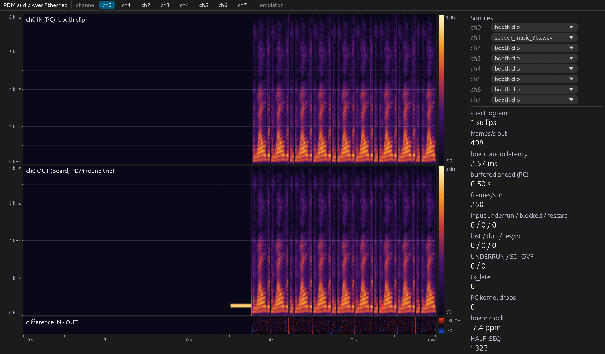

# pdm-eth: PC application of pdm_audio_eth

Talks raw Ethernet (EtherType 0x88B5) to the LP-AM243 running
[pdm_audio_eth](../pdm_audio_eth/readme.md): Ethernet test, live
spectrograms of the board's 8-channel PDM round trip, streaming WAV files in,
capturing WAV files out. Linux only (AF_PACKET).

## Build

```
cargo build --release
sudo setcap cap_net_raw,cap_net_admin+ep target/release/pdm-eth   # after every build
sudo nmcli device set enp129s0 managed no                          # once
cargo test                                                          # no board needed
```

Every command takes `--iface IFACE` (default `enp129s0`) or `--emulator`, an
in-process board model with the same frames, for work without the board.

## Commands

| Command | What it does |
| ------- | ------------ |
| `pdm-eth test [--pings N] [--seconds S]` | link speed/duplex, ping-pong RTT (min/mean/p99/max) and the board's turnaround, throughput both ways; one PASS/FAIL line per step |
| `pdm-eth capture --seconds S --out DIR` | board output to `DIR/out_ch0..7.wav` (16 kHz, 24-bit), loss and board counters |
| `pdm-eth stream --ch0 a.wav ... --ch7 h.wav [--capture DIR] [--lead 8000]` | streams the files (any rate, converted to 16 kHz mono, peak 0.5 FS), stops at the end of the longest; `--capture` writes `in_ch*.wav` and `out_ch*.wav` |
| `pdm-eth gui [--ch0 a.wav ...] [--export-shm NAME]` | the booth window (layout C): one channel large, input above output and their dB difference, live numbers on the right; each file loops on its own length, channels without a file play their booth clip |

**Custom audio per channel:** the "Sources" table at the top of the side
panel has one selector per channel: *booth clip* (the board's own clip of
that channel), *speech*, *music*, *speech + music* (the example files in
`audio/`, compiled in; origin and licence in `audio/SOURCES.md`), *silence*,
or *open WAV file...* (the desktop's file dialog; any rate, stereo mixed
down, scaled to 0.5 FS like `--chN`). A choice plays live, without a
restart; the first one starts the stream to the board, the channels nobody
changed play their booth clips. The IN pane names the channel's source.

GUI options for documentation: `--screenshot PNG` saves the window after 5 s
and exits; under Wayland run it with `WAYLAND_DISPLAY` unset (XWayland), since a
hidden Wayland window draws no frames. `--no-vsync` draws without waiting for
the display (a hidden window is otherwise throttled by the compositor to about
1 fps; a visible window runs at the display rate).



Each spectrogram has its frequency scale on the left (0 to 8 kHz, grid every
1 kHz), its colour scale on the right (IN and OUT: -90 to 0 dB, a full-scale
sine reads 0 dB; difference: -30 to +30 dB), and the time strip at the
bottom runs from 10 s ago to now (8 ms per column).

## Side panel

| Line | Meaning |
| ---- | ------- |
| board audio latency | RTU1 taking a sample out of the clip buffer to its AUDIO_OUT frame leaving the board, on the board's IEP clock (best case over recent frames) |
| buffered ahead (PC) | how far the PC's input is ahead of RTU1 (target 0.5 s) |
| frames/s in / out | AUDIO_IN (250/s) and AUDIO_OUT (500/s) |
| input underrun / blocked / restart | RTU1 reached unsent audio / a block would have overwritten unread audio / the board restarted |
| lost / dup / resync | AUDIO_OUT frames missing, doubled, index jumps (board reset) |
| UNDERRUN / SD_OVF, tx_late | ICSSG0 and ICSSG1 PRU0 counters from the status block |
| board clock | board IEP against the PC clock, ppm |

## Processing seam

For the later GPU projects (cepstrum, speaker separation, noise and echo
cancellation): `src/seam.rs` has a `Stage` trait for in-process processing of
aligned 64-frame input/output blocks, and `--export-shm NAME` writes the same
blocks to a ring in `/dev/shm/NAME` for another process; the layout is in the
module documentation of `src/seam.rs`. A killed `pdm-eth` leaves the file
behind; the next start recreates it.

## Modules

`proto` frames, `link` AF_PACKET, `emulator` board model, `ethtest`, `rx`
reconstruction and WAV capture, `wavin` WAV input, `pacing` AUDIO_IN timing,
`latency`, `spectro`, `ui`, `seam`.
