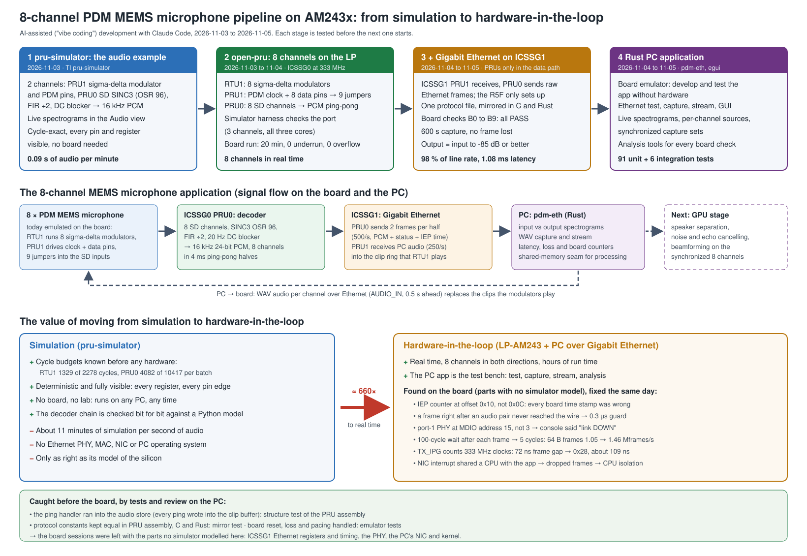

# Development flow: from a simulator example to an 8-channel PDM audio pipeline over Gigabit Ethernet

How the electronica 2026 PDM audio demo was built, in three days, with
AI-assisted development ("vibe coding") in Claude Code. It started from an
audio example in TI's pru-simulator, moved to 8 channels on the AM243x
LaunchPad, gained a Gigabit Ethernet link and a Rust PC application, and
ended in a board run of ten hardware-in-the-loop checks. How to run the
result: [demo_howto.md](demo_howto.md).

(`development_flow.png` is the same diagram as a picture, for slides.)

## 1. The application

The target is an **8-channel PDM MEMS microphone front end** on the AM243x
PRU-ICSSG. The plan:

1. Eight digital MEMS microphones deliver 1-bit PDM streams.
2. The PRU's sigma-delta (SD) hardware decodes them into 16 kHz PCM.
3. A second PRU subsystem streams the PCM to a PC over Gigabit Ethernet.
4. A GPU on the PC processes the eight synchronized channels: speaker
   separation, noise and echo cancelling, beamforming.

The demo builds and proves everything up to the PC, with one substitution:
the microphones are emulated on the board. ICSSG0 RTU1 runs eight
sigma-delta modulators on known audio. ICSSG0 PRU1 drives the PDM clock and
eight data pins, and nine jumper wires feed them back into the SD inputs of
ICSSG0 PRU0. The input is known, so the output can be checked exactly. The
PC can also stream its own audio into the modulators, so the round trip
PC → PDM → PC is visible live. Replacing the jumpers by real microphones
changes the source, not the decoder.

## 2. How the work was done

Every stage followed the same loop, with the human deciding and the AI doing
the bulk of the writing, coding and checking:

| Step | Human | Claude Code |
| ---- | ----- | ----------- |
| Intent | states the goal ("port to open-pru, 8 channels, max 333 MHz") | asks the open questions one at a time |
| Design | answers, decides between options | writes the design document; every decision is marked as the user's or as "my call, for review" |
| Plan | approves | splits the design into tasks with tests, constraints and the files each task touches |
| Build | - | implements task by task; every task gets tests first, an implementer, a reviewer and a ledger entry (subagent-driven development) |
| Review | - | a fresh reviewer reads the whole branch; findings are fixed with a test that fails first |
| Board | hands at the board: loads in CCS, reads the console and the memory view, watches the screen | runs the PC tools, analyses every result, finds the cause, fixes and documents it |
| Report | approves, commits, pushes | test report, readme, this document |

Rules kept throughout:

- Doc first: design and plan before code.
- Tests first: a fix always comes with a test that failed before it.
- No claim without evidence. Wrong guesses are recorded too. Two theories
  about the Ethernet frame gap were disproved on the board and are written
  down in the test report.
- Nothing is pushed without the user.

## 3. Stage 1: the audio example in the pru-simulator (2026-11-03)

**Repository:** `pru_simulator`, branch `feat/pdm-audio-demo` (PR #106, 31
commits), report `docs/reports/2026-11-03-pdm-audio-demo-report.md`.

- **What runs:**
  - PRU1: a second-order sigma-delta modulator that turns 16 kHz clips into
    PDM;
  - PRU0: the SD hardware (SINC3, OSR 96), then a comb, FIR /2, DC blocker
    and saturation to 24 bit, giving 16 kHz PCM;
  - two channels, shown as live spectrograms in the simulator's Audio view.
- **Simulator work it needed:**
  - a pin-driven PDM link into the SD model (clock select, inversion);
  - an exact idle skip;
  - run-ahead for a producer/consumer pair.
- **Speed:** 0.09 s of audio per minute of simulation, about 11 minutes per
  second of audio. That is the booth's comparison number.
- **Why start here:**
  - The algorithm, the register use and the cycle budget can be checked with
    every pin and register visible, before any hardware.
  - The decoder chain is checked bit for bit against a Python reference
    model.

## 4. Stage 2: port to open-pru, 8 channels on the LaunchPad (2026-11-03 to 11-04)

**Repository:** `open-pru`, branch `dev_tley_electronica2026_pdm_audio` (21
commits), `examples/electronica2026/pdm_audio`, with design, plan and porting
report in its `docs/`.

- **User decisions:**
  - one PDM output per channel, up to 8 channels, at most 333 MHz;
  - RTU1 allowed, clips in MSRAM, one shared SD clock;
  - PCM in ping-pong halves, ready for a later Ethernet PRU;
  - board check in the CCS memory browser.
- **Design result:**
  - RTU1 runs the eight modulators. It cannot drive pins, so it hands bits to
    PRU1 through the IPC scratchpad.
  - PRU1 drives the clock and the data pins.
  - PRU0 decodes eight SD channels.
  - The core clock is 333.33 MHz.
- **Board facts found from the schematic:**
  - only nine PRU1 outputs reach the headers, so 8 channels is the hard
    maximum;
  - SD4's input goes to the Ethernet PHY, so it is skipped;
  - SW6 must stay in its default position.
- **Before the board:**
  - A pru-simulator harness runs the port's firmware on three channels with
    all three cores in lockstep, and checks every PCM sample against the
    reference.
  - Cycle budgets per batch: RTU1 1329 of 2278 cycles, PRU0 (8 channels)
    4082 of 10 417.
- **Board run, 2026-11-04 — PASSED:**
  - after 20 minutes UNDERRUN_COUNT 0 and SD_OVF_COUNT 0;
  - all counters give the same run time;
  - the five tones at the right frequency, about -90 dB fit residual;
  - PDM clock 3.072 MHz on a PicoScope.

## 5. Stage 3: Gigabit Ethernet on ICSSG1 (2026-11-04 to 11-05)

**Repository:** `open-pru`, branch `dev_tley_electronica2026_pdm_audio_eth`,
stacked on the stage-2 branch. `examples/electronica2026/pdm_audio_eth`:
design, plan, test report and this document in `pdm_audio_eth/docs/`.

- **User decisions:**
  - PRUs only in the data path, the R5F only sets up;
  - ICSSG1 port 1 (RGMII2), taken from the user's own tested HIL Ethernet
    example;
  - standard frames: each 2 KB PCM half goes as two 1 KB frames with a sample
    index and the board time;
  - board latency shown, PC 0.5 s ahead;
  - staged: Ethernet test, then board → PC, then PC → board;
  - no simulator work: "the board is the test bench for Ethernet".
- **Design result:**
  - ICSSG1 PRU0 sends:
    - two AUDIO_OUT frames per 4 ms half;
    - pongs;
    - throughput frames and reports.
  - ICSSG1 PRU1 receives:
    - pings;
    - throughput frames;
    - control frames;
    - AUDIO_IN, written into the clip ring that RTU1 already loops.
  - The ICSSG0 PDM chain stays byte for byte as in stage 2. The protocol is
    defined once (`eth_proto.inc`), mirrored in C and Rust, and a test keeps
    all three equal.
- **Built and checked off the board:**
  - 16 plan tasks;
  - every PRU file assembled and linted;
  - the Rust app tested against a board emulator;
  - a final review found a critical bug, fixed with a failing test first: the
    ping handler ran into the audio store, so every ping would have written
    into the clip buffer.
- **Board session, 2026-11-05** (details in [test_report.md](test_report.md),
  section 6). The user ran the board in CCS; the PC tools ran from the
  session. Found and fixed on the board:

| Finding | Fix |
| ------- | --- |
| board time stamps wrong | the ICSSG IEP count is at offset 0x10, 0x0C is another register |
| the frame sent right after an audio pair never reached the wire | 0.3 µs guard after an audio pair |
| the NIC dropped frames at full rate | NIC interrupt and network thread on separate isolated CPUs |
| console said "link DOWN" while data flowed | the HIL example had the two PHY addresses swapped: J18 is PHY 15 |
| 64-byte frames only 1.05 Mframes/s | PRU0's 100-cycle wait after each frame came from the HIL example, which only waited before halting; the TRM needs 5 cycles |
| then the frame gap was too short (85 ns) | `TX_IPG` counts 333 MHz core clocks; 0x28 gives about 109 ns. The TX-clock mode the TRM suggests was slower on this silicon |

- **Result:** all ten checks B0 to B9 passed:
  - 64-byte frames from the board at 98 % of line rate;
  - a 600 s capture with no lost frame and the tones at the stage-2 levels;
  - 8 channels streamed in and back, matching the input to -85 dB or better;
  - board audio latency 1.08 ms.

## 6. Stage 4: the Rust PC application (2026-11-04 to 11-05)

**`pdm_audio_eth/pc_app`**, about 5400 lines of Rust, 91 unit and 6
integration tests.

- **Built against an emulator first:** an in-process board model with the
  same frames, loss and reset behaviour. The app was tested without hardware
  and was ready when the board was.
- **Commands:**
  - `test`: link, pings and throughput both ways, PC and board loss kept
    apart;
  - `capture`;
  - `stream`;
  - `gui`: input and output spectrograms, difference strip, live numbers.
- **After the board run, the user asked for booth changes:**
  - spectrogram scales;
  - larger fonts;
  - example audio: public-domain speech and CC0 music, licences checked and
    recorded;
  - a source selector per channel;
  - synchronized capture sets for real multi-microphone recordings (one start,
    one length, one gain).
- **Drag and drop was built first, then removed.** The windowing library has
  no file drop on Wayland, which the PC runs. The design document records
  this.
- **Analysis tools** (`pdm_audio_eth/tools`) turn every board check into a
  number:
  - clip-buffer compare;
  - capture analysis;
  - PCM-half spot check;
  - stream input versus output.

## 7. Simulation and hardware-in-the-loop: what each gave

| | Simulation (pru-simulator) | Hardware-in-the-loop (LP-AM243 + PC) |
| - | -------------------------- | ------------------------------------ |
| Speed | about 11 min per second of audio | real time, about 660 times faster |
| Visibility | every register and pin edge, deterministic | console, CCS memory view, the PC tools' counters |
| Cost of a run | none: any PC, any time | a board, a cable, a person at the bench |
| Found | logic, data flow, cycle budgets, bit-exact decoder output | silicon register details, Ethernet timing, PHY addressing, the PC's NIC and kernel |
| Limits | only as right as its model; no PHY, NIC or OS | slower to observe; a fault shows as a number, not a trace |

Lessons from this project:

- **Simulate what the simulator models, then move to hardware.** Stage 1 and
  the stage-2 harness settled the algorithm and the cycle budgets before the
  8-channel board run, which then had only the board itself to prove.
- **Make the PC the test bench.** The Ethernet stage had no simulator model.
  Every board check was instead a PC command with a number (loss, rate,
  residual, latency), so a session could test, fix and re-test within
  minutes.
- **Test offline what you can.** The board emulator, the structure tests of
  the PRU assembly and the protocol mirror test caught the critical ping bug
  and kept three languages in step. The board sessions were left with what
  nothing here modelled.
- **Record wrong guesses.** Two explanations of the frame-gap result were
  disproved on the board. Writing them down kept the test report honest and
  stopped the same guess from coming back.

## 8. Numbers

| | |
| - | - |
| Calendar time | 2026-11-03 to 2026-11-05 |
| Commits | pru_simulator: 31 (demo) + 9 (port check); open-pru: 21 (8-channel port) + 61 (Ethernet, PC app, board results) |
| PRU assembly | about 1500 lines PDM chain, about 640 lines Ethernet |
| Rust | about 5400 lines, 97 tests |
| Board checks | stage 2: 1 run passed; stage 3: B0 to B9 passed |
| Results | 8 channels both ways in real time; board latency 1.08 ms; 600 s capture lossless; 64 B frames at 98 % of line rate |

## 9. Where to find what

| What | Where |
| ---- | ----- |
| Simulator example | `pru_simulator`: `source/pdm/`, `docs/reports/2026-11-03-pdm-audio-demo-report.md` |
| 8-channel port | `open-pru`: `examples/electronica2026/pdm_audio/pdm_audio/` (readme, `docs/design.md`, `docs/porting_report.md`) |
| Ethernet project | `open-pru`: `examples/electronica2026/pdm_audio_eth/pdm_audio_eth/` (readme, `docs/design.md`, `docs/plan.md`, `docs/test_report.md`) |
| PC application | `open-pru`: `examples/electronica2026/pdm_audio_eth/pc_app/` (README, `audio/SOURCES.md`) |
| Running the demo | [demo_howto.md](demo_howto.md) |
